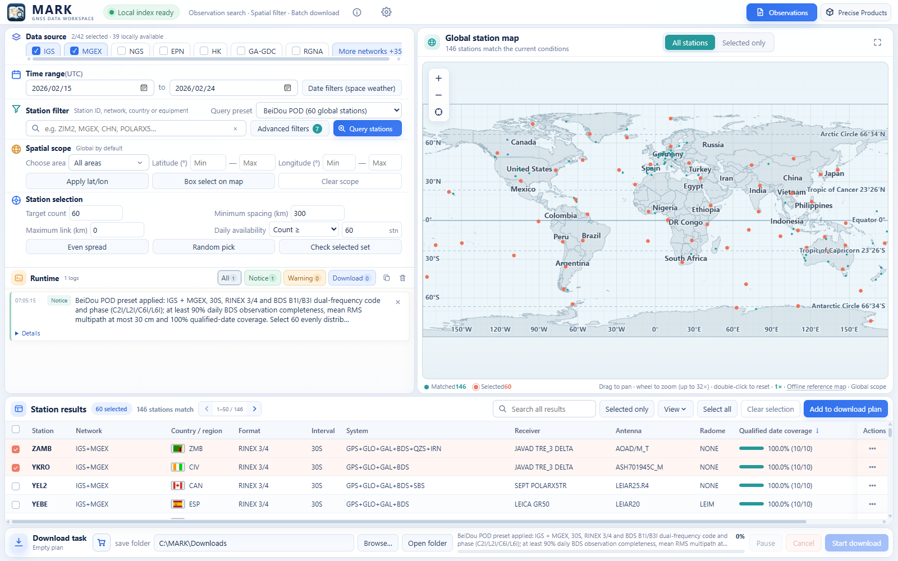
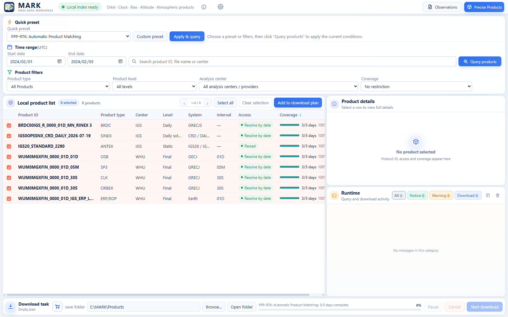

# MARK

**Metadata-Guided Automation of Resource Workflows**

Find GNSS observation files and precise products using local metadata, station history and selection rules.

**v1.0.0 · Windows 10/11 x64**

[Release details](https://github.com/qiliu2025/MARK/releases/latest) · [User manual (English PDF)](docs/USER_MANUAL_EN.pdf)

**Code → Download ZIP contains source code.** To install MARK, use the Windows installer above or open [Releases](https://github.com/qiliu2025/MARK/releases/latest). If you already downloaded the source ZIP, open [DOWNLOAD_MARK.html](DOWNLOAD_MARK.html) for the download links.

通过 **Code → Download ZIP** 只能获取源码。 下载软件请点击上方 Windows 下载按钮，或前往 [Releases](https://github.com/qiliu2025/MARK/releases/latest)。已下载源码 ZIP 的用户，也可打开 [DOWNLOAD_MARK.html](DOWNLOAD_MARK.html) 获取下载链接。

## Screenshots

### Observation search

### Precise products

## Features

- Search observations by date, station network, country and location.
- Inspect receiver, antenna, radome, RINEX and satellite-system history.
- Filter equipment, availability, reference frames, observation codes and space-weather dates.
- Apply daily IGS/MGEX quality criteria, with independent constellation selection for completeness, RMS multipath and cycle slips.
- Find precise products and save custom product presets.
- Prepare download plans and retrieve original files through supported HTTPS, FTP, FTPS and SFTP routes.
- Keep per-task file results and completion summaries in the download folder's `logs/` directory.

## Data coverage

The release contains **64 DuckDB knowledge bases**, with data dates through **2026-08-01 inclusive**.

Local queries work offline. Downloads use the original providers and require network access and any provider authorization.

## Install and run

1. Download `MARK-v1.0.0-Windows-x64.exe` from [Releases](https://github.com/qiliu2025/MARK/releases/latest).
2. Run the installer and choose an empty folder. Setup checks the required space and prepares the knowledge bases.
3. Start MARK from its shortcut or `software/MARK.exe` in the selected folder.

Windows 10/11 x64 and Microsoft Edge WebView2 Evergreen Runtime are required. Python and a separate 7-Zip installation are not needed. SFTP sources require Windows OpenSSH Client.

The installation occupies about **10.6 GB** and includes the English PDF user manual and corresponding MARK source archive. Each new installation starts in English and remembers later language choices. Keep `software/` and `knowledge-base/` together.

## Documentation

- [User manual (English PDF)]
- [Build instructions](docs/BUILD.md)

## Licenses

Original MARK source is available for **noncommercial scientific research only** under [LICENSE](LICENSE). Viewing, modifying and compiling the source for that purpose are permitted. **Commercial use requires prior written permission** from the MARK copyright holders. This is a source-available research license. Third-party components retain their original licenses; see [THIRD_PARTY_NOTICES.md](THIRD_PARTY_NOTICES.md).

The knowledge bases use [separate proprietary terms](KNOWLEDGE_BASE_LICENSE.md). They are excluded from the application source license. Original data providers retain their rights and attribution requirements.

## Feedback

Report problems in [Issues](https://github.com/qiliu2025/MARK/issues), including the application version, date range, data source or product, and relevant logs. Remove passwords, tokens and private values before sharing logs.
